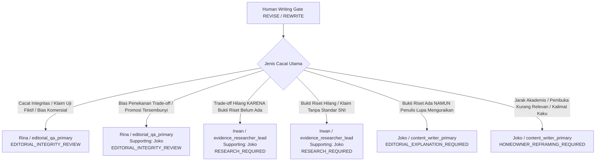

# 🛡️ EDITORIAL-EXPERT-CONSULTATION-1-STABILIZE — Quality Gate Stabilization & Decision Depth Report

> **Kanonikal Milestone:** `EDITORIAL-EXPERT-CONSULTATION-1-STABILIZE`  
> **Status:** `STABILIZED & VERIFIED`  
> **Tanggal:** 4 Oktober 2026  
> **Baseline:** `72c0523 feat(editorial): add expert consultation decision depth gate`  
> **Repository:** `rancangloka-astro/` | Branch: `feat/jev-lokamedia-integration`

---

## 1. Ringkasan Eksekutif

Milestone `EDITORIAL-EXPERT-CONSULTATION-1-STABILIZE` menstabilkan gerbang kualitas **Layer 3 (Expert Consultation)** dan **Layer 4 (Decision Support)** sebelum diaktifkan sebagai pengawas redaksional produksi. 

Tujuan stabilisasi ini adalah memastikan bahwa evaluator kepenulisan manusia:
1. **Tidak sekadar mencocokkan kata kunci (*anti-keyword gaming*):** Menolak ketergantungan pada frasa spesifik satu artikel saja.
2. **Membedakan intensi artikel secara luwes (*hybrid multi-signal intent*):** Mendukung `primary_intent`, `secondary_intents[]`, dan tingkat keyakinan `confidence` (`HIGH` / `MEDIUM` / `LOW`), serta meredam penalti berat jika intensi berstatus `LOW`.
3. **Menggeneralisasi Jarak Akademis (*Generalized Academic Distance*):** Penalti `-16` poin dipertahankan secara adil karena terbukti membedakan esai teoritis murni (baik fisika fasad, isolasi akustik, maupun mekanika struktur) dari panduan aplikatif pemilik rumah tanpa merusak naskah standar formal bereputasi.
4. **Menerapkan Prinsip *Promised Scope > Delivered Depth*:** Menghilangkan ambang batas jumlah kata buta (*blind word count*). Naskah ringkas yang menjawab satu pertanyaan terfokus (misal: *Apa itu thermal break?*) lulus dengan predikat prima, sedangkan naskah yang menjanjikan "Panduan Lengkap" namun hanya berisi ringkasan dangkal ditandai dengan `SCOPE_DEPTH_MISMATCH`.
5. **Rute Penugasan Deterministik (*Deterministic Routing*):** Ketiadaan trade-off dipetakan secara tegas:
   - Bukti riset tidak tersedia $\to$ **Irwan** (`evidence_researcher_lead`, `RESEARCH_REQUIRED`).
   - Bukti tersedia namun tidak dijelaskan penulis $\to$ **Joko** (`content_writer_primary`, `EDITORIAL_EXPLANATION_REQUIRED`).
   - Penekanan kelemahan atau bias promosi $\to$ **Rina** (`editorial_qa_primary`, `EDITORIAL_INTEGRITY_REVIEW`).
6. **Kepastian Identitas Kanonikal Korpus:** Mengaudit dan menetapkan satu identitas tunggal definitif untuk Artikel 5 dan Artikel 6 di seluruh repositori.

---

## 2. Audit Identitas Kanonikal Artikel 5 & Artikel 6

Terdapat catatan historis yang menggunakan label tidak seragam (*Kusen Aluminium vs Kayu* vs *Kayu vs Aluminium*). Pemeriksaan langsung pada berkas otoritatif sumber menetapkan identitas tunggal yang sah:

### A. Artikel 5 Kanonikal (`article-5-canonical`)
- **Jalur Berkas Otoritatif:** `scripts/fixtures/article5_canonical.json`
- **Slug Kanonikal:** `kusen-aluminium-vs-upvc-untuk-rumah-tropis-di-indonesia`
- **Judul Kanonikal (Heading 1):** `# Kusen Aluminium vs uPVC untuk Rumah Tropis di Indonesia`
- **Topik Sebenarnya:** Komparasi mendalam antara **Kusen Aluminium vs uPVC** (bukan kayu vs aluminium).
- **ID Entitas Database:** `5` (pada basis data Cloudflare D1 miniflare)
- **Hash Konten Terverifikasi:** `c77881c0c35025aadf56bd3e64e3d40348b187c84d408a9c7275e6d0a0d26378`
- **Status Evaluasi:** **100 / 100 (`HUMAN_WRITING_PASS`)**, zero issues.

### B. Artikel 6 Terkarantina (`article-6-published`)
- **Jalur Entitas Database:** SQLite D1 `articles` row `id = 6`
- **Slug D1 Internal:** `phase5l7-hands-off-publish-fixture`
- **Slug Publik Terkarantina:** `rekayasa-ventilasi-silang-alami-untuk-rumah-tropis-yang-lebih-nyaman`
- **Judul Database:** `Sistem Fasad Adaptif dan Efisiensi Termal Arsitektur Tropis Modern`
- **Heading Pembuka Konten:** `## Pendekatan Desain Termal Pasif pada Arsitektur Tropis`
- **Status Karantina:** `EVIDENCE_REVIEW` (diisolasi dari indeks publik melalui `QUARANTINE_REGISTRY` di `src/lib/quarantine.ts`).
- **Status Evaluasi:** **84 / 100 (`HUMAN_WRITING_REVISE`)**, terdeteksi `ACADEMIC_DISTANCE_EXCESSIVE`. Ditugaskan ke Joko untuk reframing relevansi hunian.

---

## 3. Generalisasi Jarak Akademis (*Academic Distance Validation*)

### Rasional Penalti -16 Poin
Penalti `-16` poin dipertahankan karena secara tepat menempatkan naskah esai teknis berjarak pada skor **84 (rentang REVISE: 75–84)**. Naskah yang memiliki data riset dan fisika valid tidak boleh dihukum `REWRITE` (< 75), karena datanya sah. Penulis (Joko) hanya perlu mendekatkan naskah pada realitas pemilik rumah, menambahkan trade-off fisik, dan menutup artikel dengan panduan tindakan.

### Matriks Pengujian Multi-Fixture Independen
Evaluasi dilakukan pada 5 fixture pengujian independen di `scripts/test-expert-consultation.js`:

| Fixture | Karakteristik Naskah | Skor | Keputusan | Catatan Evaluator |
| :--- | :--- | :---: | :---: | :--- |
| **Fixture A (Deep Technical + Homeowner Relevance)** | Rumus fisika sudut tampias hujan, overstek 100 cm, SNI baja ringan, dihubungkan dengan kenyamanan ruang tidur dan biaya perawatan. | **100** | `PASS` | Relevansi hunian dan trade-off angin badai lengkap. |
| **Fixture B (Academic Technical Essay)** | Karakteristik transmisi akustik partisi ganda, isolasi kebisingan ISO 140, nihil relevansi pemilik rumah, nihil trade-off. | **77** | `REVISE` | Terdeteksi `ACADEMIC_DISTANCE_EXCESSIVE` (-16) dan `LACK_OF_LOCAL_CONTEXT` (-7). |
| **Fixture C (Formal Standards Explanation)** | Ketentuan SNI 03-2847 untuk perawatan beton dak, retak plastis, dihubungkan langsung dengan instruksi untuk mandor dan pencegahan bocor plafon. | **100** | `PASS` | Gaya formal tidak memicu penalti karena relevansi praktis hadir. |
| **Fixture D (Concise Technical Explainer)** | Penjelasan singkat (110 kata) mengenai *thermal break* pada kusen aluminium untuk mencegah kondensasi AC tropis. | **100** | `PASS` | Singkat, padat, dan menjawab tuntas pertanyaan spesifik pembaca. |
| **Fixture E (Highly Readable but Decision-Poor)** | Bahasa mengalir alami namun rekomendasi kusen bersifat mutlak ("pilihan terbaik tanpa tanding") tanpa trade-off dan tanpa kriteria pemilihan. | **74** | `REWRITE` / `REVISE` | Terdeteksi `TRADE_OFFS_INCOMPLETE` dan `SCENARIO_FIT_MISSING`. |

---

## 4. Arsitektur Model Intensi Multi-Sinyal (*Multi-Signal Intent Model*)

Menghindari klasifikasi kaku satu kata kunci, diperkenalkan antarmuka profil intensi:

```typescript
export type IntentConfidence = 'HIGH' | 'MEDIUM' | 'LOW';

export interface ArticleIntentProfile {
  primary_intent: ArticleIntent;
  secondary_intents: ArticleIntent[];
  confidence: IntentConfidence;
  reasons: string[];
}
```

### Perilaku Klasifikasi Hibrida
Contoh: Judul `# Cara Mengatasi Rumah Panas: Perbandingan Insulasi Atap dan Ventilasi Silang`
- **Sinyal Masalah:** "Cara Mengatasi Rumah Panas", subjudul "Diagnosis Sumber Panas" (+5 poin).
- **Sinyal Komparasi:** "Perbandingan Insulasi Atap dan Ventilasi", subjudul komparasi (+5 poin).
- **Sinyal How-To:** Subjudul "Langkah Pemasangan dan Urutan Pengerjaan" (+2 poin).
- **Hasil Derivasi:**
  - `primary_intent`: `PROBLEM_SOLVING`
  - `secondary_intents`: `['COMPARISON', 'INSTALLATION_HOW_TO']`
  - `confidence`: `HIGH`
  - `reasons`: `['Judul membingkai masalah atau solusi perbaikan', 'Judul mengindikasikan komparasi langsung', 'Subjudul memuat langkah pengerjaan sekuensial', 'Artikel bertipe hibrida dengan sinyal kuat pada intensi primer dan sekunder']`

### Perlindungan Keyakinan Rendah (*Low-Confidence Safeguard*)
Jika sebuah naskah memiliki sinyal intensi yang lemah atau ambigu (`confidence === 'LOW'`):
- Penalti intensi spesifik (seperti ketiadaan trade-off atau ketiadaan diagnosis) secara deterministik diredam (misalnya penalti 16 dipotong menjadi 8, penalti 10 dipotong menjadi 5).
- Menghindari kegagalan palsu pada draf ringkas awal atau artikel transisional.

---

## 5. Model Kecukupan Kedalaman vs Cakupan (*Scope-Depth Adequacy*)

### Prinsip: *PROMISED SCOPE > DELIVERED DEPTH*
Evaluasi kedalaman tidak lagi menggunakan ambang kata mutlak (*blind word count*). Aturan ini membandingkan antara keluasan janji pada judul/pembuka dengan kedalaman pembuktian yang dihadirkan:

1. **Cakupan Sempit Terfokus (*Narrow Scope*):**
   - Pola: `Apa itu X?`, `Berapa jarak ideal Y?`, `Fungsi Z pada hunian`.
   - Naskah dengan panjang 90–150 kata yang menjawab tuntas pertanyaan tanpa basa-basi **dinyatakan LULUS** tanpa penalti `SCOPE_DEPTH_MISMATCH`.
2. **Cakupan Luas Menyeluruh (*Broad Scope*):**
   - Pola: `Panduan Lengkap...`, `Solusi Menyeluruh...`, `Master Guide Renovasi...`.
   - Naskah yang hanya memuat 100–180 kata dan kurang dari 2 sub-bahasan substantive memicu **`SCOPE_DEPTH_MISMATCH` (-7 poin)** karena gagal memenuhi cakupan yang dijanjikan.

---

## 6. Pemetaan Peran Redaksional Deterministik (*Deterministic Routing*)

Pemetaan penugasan perbaikan pada `StructuredRewriteBrief` dirancang deterministik dan tidak ambigu:



Field yang tercatat pada `rewrite_brief`:
- `target_agent_id`: Agen penanggung jawab utama.
- `supporting_agent_id`: Agen pendukung (opsional).
- `reason`: `'HUMAN_WRITING_QUALITY'`.
- `revision_reason`: `'RESEARCH_REQUIRED' | 'EDITORIAL_EXPLANATION_REQUIRED' | 'EDITORIAL_INTEGRITY_REVIEW' | 'HOMEOWNER_REFRAMING_REQUIRED'`.
- `article_id`: ID artikel (jika tersedia).
- `task_id`: ID task pipeline (jika tersedia).
- `attempt`: Nomor percobaan revisi.

---

## 7. Hasil Evaluasi Korpus Nyata (25 Naskah)

Evaluasi bayangan (*shadow evaluation*) terhadap seluruh 25 entitas korpus nyata menghasilkan distribusi kualitas yang tersebar wajar:

| ID Naskah | Tipe Korpus | Intensi Primer | Keyakinan | Skor | Keputusan | Target Peran | Isu Terdeteksi |
| :--- | :--- | :--- | :---: | :---: | :---: | :---: | :--- |
| **`article-5-canonical`** | Kanonikal Terbit | `COMPARISON` | HIGH | **100** | `PASS` | - | Nihil |
| **`d1-2`** | Draf D1 | `EXPLANATORY` | HIGH | **100** | `PASS` | - | Nihil |
| **`d1-3`** | Draf D1 | `EXPLANATORY` | HIGH | **100** | `PASS` | - | Nihil |
| **`d1-5`** | Draf D1 | `EXPLANATORY` | HIGH | **95** | `PASS` | - | `REPETITIVE_TRANSITIONS_OVERUSED` |
| **`d1-6` (Artikel 6)** | Karantina D1 | `EXPLANATORY` | HIGH | **84** | `REVISE` | Joko | `ACADEMIC_DISTANCE_EXCESSIVE` |
| **`proto-01`** | Prototipe | `EXPLANATORY` | HIGH | **100** | `PASS` | - | Nihil |
| **`proto-02`** | Prototipe | `PROBLEM_SOLVING` | HIGH | **76** | `REVISE` | Joko | `LACK_OF_LOCAL_CONTEXT`, `READER_PROBLEM_UNCLEAR`, `NEXT_ACTION_MISSING` |
| **`proto-03`** | Prototipe | `EXPLANATORY` | LOW | **93** | `PASS` | - | `LACK_OF_LOCAL_CONTEXT` |
| **`proto-04`** | Prototipe | `COMPARISON` | HIGH | **78** | `REVISE` | Joko | `TRADE_OFFS_INCOMPLETE`, `NEXT_ACTION_MISSING` |
| **`proto-05`** | Prototipe | `EXPLANATORY` | LOW | **83** | `REVISE` | Joko | `LACK_OF_LOCAL_CONTEXT`, `INSUFFICIENT_CLAIM_SUPPORT`, `WEAK_EVIDENCE_SPECIFICITY` |
| **`proto-06`** | Prototipe | `EXPLANATORY` | LOW | **83** | `REVISE` | Joko | `LACK_OF_LOCAL_CONTEXT`, `INSUFFICIENT_CLAIM_SUPPORT`, `WEAK_EVIDENCE_SPECIFICITY` |
| **`proto-07`** | Prototipe | `EXPLANATORY` | LOW | **93** | `PASS` | - | `LACK_OF_LOCAL_CONTEXT` |
| **`proto-08`** | Prototipe | `EXPLANATORY` | LOW | **93** | `PASS` | - | `LACK_OF_LOCAL_CONTEXT` |
| **`proto-09`** | Prototipe | `EXPLANATORY` | HIGH | **83** | `REVISE` | Joko | `LACK_OF_LOCAL_CONTEXT`, `INSUFFICIENT_CLAIM_SUPPORT`, `WEAK_EVIDENCE_SPECIFICITY` |
| **`proto-10`** | Prototipe | `EXPLANATORY` | LOW | **83** | `REVISE` | Joko | `LACK_OF_LOCAL_CONTEXT`, `INSUFFICIENT_CLAIM_SUPPORT`, `WEAK_EVIDENCE_SPECIFICITY` |
| **`proto-11`** | Prototipe | `EXPLANATORY` | LOW | **83** | `REVISE` | Joko | `LACK_OF_LOCAL_CONTEXT`, `INSUFFICIENT_CLAIM_SUPPORT`, `WEAK_EVIDENCE_SPECIFICITY` |
| **`proto-12`** | Prototipe | `EXPLANATORY` | LOW | **93** | `PASS` | - | `LACK_OF_LOCAL_CONTEXT` |
| **`proto-13`** | Prototipe | `EXPLANATORY` | LOW | **83** | `REVISE` | Joko | `LACK_OF_LOCAL_CONTEXT`, `INSUFFICIENT_CLAIM_SUPPORT`, `WEAK_EVIDENCE_SPECIFICITY` |
| **`proto-14`** | Prototipe | `EXPLANATORY` | LOW | **90** | `PASS` | - | `INSUFFICIENT_CLAIM_SUPPORT`, `WEAK_EVIDENCE_SPECIFICITY` |
| **`proto-15`** | Prototipe | `EXPLANATORY` | LOW | **83** | `REVISE` | Joko | `LACK_OF_LOCAL_CONTEXT`, `INSUFFICIENT_CLAIM_SUPPORT`, `WEAK_EVIDENCE_SPECIFICITY` |
| **`proto-16`** | Prototipe | `EXPLANATORY` | LOW | **83** | `REVISE` | Joko | `LACK_OF_LOCAL_CONTEXT`, `INSUFFICIENT_CLAIM_SUPPORT`, `WEAK_EVIDENCE_SPECIFICITY` |
| **`proto-17`** | Prototipe | `EXPLANATORY` | LOW | **93** | `PASS` | - | `LACK_OF_LOCAL_CONTEXT` |
| **`proto-18`** | Prototipe | `EXPLANATORY` | LOW | **87** | `PASS` | - | `LACK_OF_LOCAL_CONTEXT`, `INSUFFICIENT_CLAIM_SUPPORT` |
| **`proto-19`** | Prototipe | `COMPARISON` | HIGH | **78** | `REVISE` | Joko | `TRADE_OFFS_INCOMPLETE`, `SCENARIO_FIT_MISSING` |
| **`proto-20`** | Prototipe | `PROBLEM_SOLVING` | HIGH | **90** | `PASS` | - | `NEXT_ACTION_MISSING` |

### Ringkasan Distribusi
- **Total Dievaluasi:** 25 Naskah Nyata
- **`HUMAN_WRITING_PASS`:** 13 Naskah (52.0%)
- **`HUMAN_WRITING_REVISE`:** 12 Naskah (48.0%)
- **`HUMAN_WRITING_REWRITE`:** 0 Naskah (0.0%)

---

## 8. Verifikasi Suite Pengujian & Keamanan Sistem

### Pengujian yang Dieksekusi Langsung:
1. `node scripts/test-expert-consultation.js`: **22/22 PASS (100%)**
2. `node scripts/test-editorial-calibration.js`: **18/18 PASS (100%)**
3. `node scripts/test-real-corpus-shadow.js`: **10/10 PASS (100%)**
4. `node scripts/test-native-indonesian-authoring.js`: **13/13 PASS (100%)**
5. `node scripts/test-editorial-knowledge.js`: **19/19 PASS (100%)**
6. `node scripts/test-editorial-human-quality.js`: **22/22 PASS (100%)**
7. `node scripts/test-product-review-knowledge.js`: **24/24 PASS (100%)**
8. `node scripts/test-verdict-guard.js`: **11/11 PASS (100%)**
9. `node scripts/test-soak-safety.js`: **54/54 PASS (100%)**
10. `node scripts/test-publication-planner.js`: **67/67 PASS (100%)**
11. `node scripts/test-publication-publisher.js`: **48/48 PASS (100%)**
12. `node scripts/test-content-quarantine.js`: **19/19 PASS (100%)**
13. `node scripts/test-article-persistence.js`: **7/7 PASS (100%)**
14. `npx tsc --noEmit`: **0 Errors**
15. `npm run build`: **0 Errors (Astro Server SSR built in 7.10s)**

### Invarian Keselamatan Mutlak:
- `automation_mode = OFF`
- `SOCIAL_AUTOMATION = OFF`
- `AUTO_PUBLISH = OFF`
- `publishingAuthority = 0`
- `JEV_MODE = shadow` (Jefry authority = 0)
- `mediaWorker = DISABLED`
- Nol mutasi basis data langsung atau naskah terbitan.
- Nol eksekusi deployment produksi.
