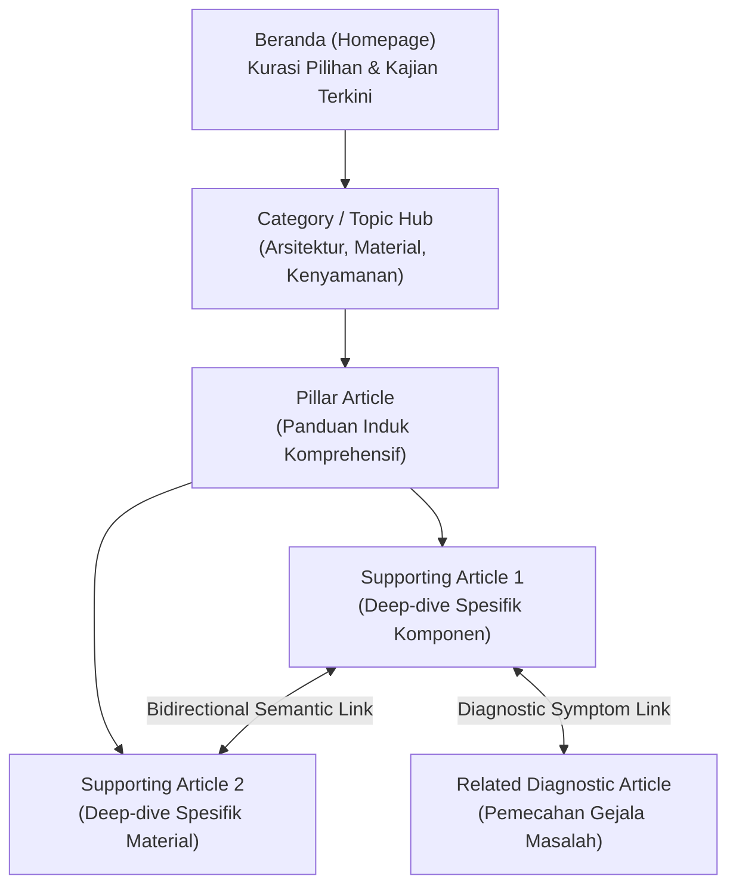
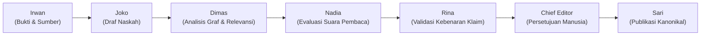

# 🧭 RancangLoka & Hermes — Internal Link Engine (INTERNAL-LINK-ENGINE-1)
## Baseline Audit & Architecture Design Specification

**Tanggal:** 2026-10-15  
**Milestone:** `INTERNAL-LINK-ENGINE-1`  
**Fase:** `AUDIT_AND_DESIGN_ONLY`  
**Status:** `DESIGN_READY` (Zero code mutation, zero database mutation, zero content hash disruption)

---

## 1. Prinsip Produk Kanonikal (Canonical Product Principle)

> **"Internal link RancangLoka harus melanjutkan perjalanan berpikir pembaca, bukan sekadar memindahkan PageRank."**

Dalam jurnalisme arsitektur dan panduan hunian RancangLoka, tautan internal (*internal links*) bukan instrumen manipulasi mesin pencari (*search engine optimization trickery*). Tautan internal hadir semata-mata karena artikel tujuan memberikan jawaban logis berikutnya atas pertanyaan nyata pemilik rumah yang sedang membaca.

Setiap tautan internal wajib lolos uji kebermanfaatan pembaca (*Reader Utility Test*):
* *"Apa yang didapatkan pembaca ketika mengklik tautan ini?"*
* Jika jawabannya semata-mata *"Menambah PageRank"* atau *"Mengejar target kuota SEO"*, maka kandidat tautan tersebut **wajib ditolak**.

Tautan internal memandu pembaca melalui 5 tahapan kognitif pengambilan keputusan arsitektural:
1. **Diagnosis Masalah (*Problem Discovery*):** Mengenali gejala kegagalan ruang (embun di kaca, hawa panas sore, tagihan AC membengkak).
2. **Pemahaman Fisika Bangunan (*Root Cause Understanding*):** Memahami mengapa hal tersebut terjadi (radiasi matahari baur BMKG, konduksi panas aluminium, jembatan termal).
3. **Komparasi Pilihan (*Options Exploration*):** Menimbang solusi arsitektural (tritisan vs louver vs awning vs fasad kedua).
4. **Kedalaman Keputusan (*Decision Depth*):** Menilai trade-off biaya, durabilitas, iklim tropis, dan standar teknis SNI/PUPR.
5. **Langkah Konkret Berikutnya (*Next Step Action*):** Mengetahui detail pemasangan, perawatan material, atau penataan ruang pendukung.

---

## 2. Hirarki Arsitektur Informasi (Target Information Architecture)

Struktur informasi RancangLoka dirancang berlapis secara hierarkis dan kontekstual:



### Empat Famili Tautan:
1. **STRUCTURAL (Struktural):** Header global, footer, navigasi kategori, dan breadcrumbs berjenjang.
2. **HIERARCHICAL (Hierarkis):** Hub Topik $\leftrightarrow$ Artikel Pilar, dan Artikel Pilar $\leftrightarrow$ Artikel Pendukung (*Supporting Articles*).
3. **CONTEXTUAL (Kontekstual):** Tautan di dalam naskah yang merujuk pada konsep prasyarat, pembuktian ilmiah, atau terminologi material terkait.
4. **BIDIRECTIONAL (Dua Arah):** Hubungan timbal balik simetris seperti Masalah $\leftrightarrow$ Solusi, Gejala $\leftrightarrow$ Akar Penyebab, atau Pilihan Material $\leftrightarrow$ Mitigasi Kegagalan.

---

## 3. Tipe Hubungan Semantik Kanonikal (Canonical Semantic Relationship Types)

Sistem Internal Link Engine V1 mendukung 9 tipe hubungan semantik yang berpusat pada pembaca:

| Tipe Hubungan | Definisi & Nilai Tambah Pembaca | Contoh Kasus Nyata |
|---|---|---|
| `PARENT_PILLAR` | Artikel tujuan adalah panduan induk komprehensif yang memayungi domain arsitektural ini. | Naskah *Louver Aluminium* menunjuk ke *Panduan Sistem Shading Luar Fasad Tropis*. |
| `CHILD_SUPPORTING` | Artikel tujuan membedah secara teknis detail komponen, rumus kalkulasi, atau studi kasus turunan dari artikel pilar. | Naskah *Sistem Shading Luar* menunjuk ke *Detail Sambungan Dak Beton Tritisan*. |
| `RELATED_PROBLEM` | Artikel tujuan mendiagnosis gejala masalah hunian yang sering terjadi bersamaan atau menjadi akar persoalan. | Naskah *Kondensasi Jendela Kaca* menunjuk ke *Masalah Sirkulasi Ruang Pengap & Lembap*. |
| `RELATED_MATERIAL` | Artikel tujuan mengulas karakteristik fisik, durabilitas, atau trade-off material yang disebutkan dalam naskah. | Naskah *Sistem Shading* menunjuk ke *Spesifikasi Fisik & Ketahanan Kayu Ulin vs Aluminium*. |
| `RELATED_DECISION` | Artikel tujuan memandu pertimbangan keputusan alternatif atau komplementer. | Naskah *Peneduh Fasad Luar* menunjuk ke *Memilih Kaca Low-E vs Kaca Bening*. |
| `BACKGROUND_EXPLAINER` | Artikel tujuan menjelaskan dasar sains fisika bangunan, standar SNI, atau metode iklim BMKG yang melandasi artikel. | Naskah yang mengutip SNI 6389:2020 menunjuk ke *Memahami Batas OTTV 35 W/m² untuk Rumah Tinggal*. |
| `NEXT_STEP` | Artikel tujuan memandu langkah operasional setelah keputusan diambil (instalasi, tukang, perawatan berkala). | Naskah *Pemasangan Louver Fasad* menunjuk ke *Jadwal & Metode Perawatan Kisi-kisi Luar*. |
| `RELATED_SYSTEM` | Artikel tujuan menghubungkan sistem bukaan dengan sistem selubung bangunan lain (atap, ventilasi silang, dinding). | Naskah *Peneduh Jendela* menunjuk ke *Rekayasa Ventilasi Silang Plafon Tropis*. |
| `RELATED_FAILURE_MODE` | Artikel tujuan menjelaskan bagaimana material atau konfigurasi tersebut dapat gagal jika salah pasang/rawat. | Naskah *Pemasangan Louver* menunjuk ke *Penyebab Tempias Air Hujan pada Bukaan Fasad*. |

> **Catatan Kebijakan Tipe Hubungan:** Tipe generik seperti `RELATED_CONTEXT` **ditolak dan dilarang**. Setiap relasi wajib memiliki intensi pembaca yang tajam. Relasi tanpa nilai tambah spesifik memicu tautan mekanis berkualitas rendah (*link slop*).

---

## 4. Audit Baseline: Kondisi Nyata RancangLoka Saat Ini

Audit menyeluruh terhadap basis kode aktif (`rancangloka-astro/`) mengungkap fakta implementasi berikut:

```
+------------------------------------+--------------------------+-------------------------------------------------------+
| Komponen Arsitektur                | Status Saat Ini          | Temuan Audit Nyata                                    |
+------------------------------------+--------------------------+-------------------------------------------------------+
| Article Renderer ([slug].astro)    | IMPLEMENTED (MECHANICAL) | Memproses HTML via regex keyword & kategori recency.  |
| Database Schema (db/schema.sql)    | ABSENT                   | Tabel relasi link / graph belum ada di basis data.   |
| Taxonomy / Tags                    | ABSENT                   | Tidak ada tabel tags; hanya 8 kategori flat.          |
| Breadcrumbs                        | PARTIAL                  | Flat 2-tingkat (Home > Kategori > Judul Artikel).      |
| In-Article "BACA JUGA" Box         | IMPLEMENTED (NAIVE)      | Mengambil artikel terbaru dari kategori yang sama.    |
| Auto-Keyword Linker (seo.ts)       | IMPLEMENTED (MECHANICAL) | Regex string match focus_keyword (max 2 link/artikel).|
| Related Articles Footer Grid       | PARTIAL (NAIVE)          | Grid 3 kartu terikat strictly pada category_id yang sama|
| Problem Solver (/solusi)           | PARTIAL (DECOUPLED)      | Masalah & solusi terisolasi; link ke /search?q=...     |
| Comparison Engine (/komparasi)     | MANUAL (ISOLATED)        | Matriks statis tanpa link ke artikel naskah terkait.  |
| Design Explorer (/explore)         | PARTIAL (CLIENT-JS)      | Filter material client-side JS; decoupled dari graph. |
| Pillar / Supporting Relationship   | ABSENT                   | Tidak ada konsep pilar dalam model data.              |
| Orphan Detection                   | ABSENT                   | Tidak ada deteksi artikel yang terisolasi.            |
| Bidirectional Link Discovery       | ABSENT                   | Tidak ada rekomendasi backlink saat artikel baru terbit|
| Content Hash Protection            | WIRED & ENFORCED         | Hash naskah (SHA-256) diproteksi gerbang Chief Editor. |
+------------------------------------+--------------------------+-------------------------------------------------------+
```

### Masalah Kritis Sistem Saat Ini:
1. **Silo Kategori Kaku:** Karena `RelatedArticles` dan box `"BACA JUGA"` mengandalkan `WHERE category_id = ?`, dua artikel yang saling melengkapi tetapi berbeda kategori sama sekali tidak akan pernah saling merekomendasikan.
2. **Auto-Keyword Naif & Buta Konteks:** `injectAutoKeywordLinks` di `src/lib/seo.ts` mencocokkan string `focus_keyword` secara mekanis melalui regex saat render runtime. Ini mengabaikan intensi pembaca dan berisiko menautkan teks ke artikel yang tidak relevan secara kontekstual.
3. **Decoupling Hub Interaktif:** Halaman `/solusi` dan `/komparasi` bekerja sebagai pulau terisolasi. Rekomendasi solusi di `/solusi` hanya mengarahkan pembaca ke query pencarian acak (`/search?q=secondary+skin`), bukan ke panduan terkurasi mendalam.

---

## 5. Audit Sampel Konten Produksi: Artikel A, B, dan C

Audit terhadap tiga artikel live di ekosistem RancangLoka:

* **Artikel A (ID 7):** *Jendela Berkondensasi: Kelembapan Ruangan, Suhu Permukaan Kaca, Ventilasi, atau Thermal Bridge?* (Kategori: `Kenyamanan Rumah` / ID 6)
* **Artikel B (ID 8):** *Thermal Bridge Kusen Aluminium: Mengapa Permukaan Kusen Terasa Sangat Panas atau Dingin?* (Kategori: `Material & Finishing` / ID 5)
* **Artikel C (ID 9):** *Memilih Sistem Shading Luar untuk Rumah Tropis: Overhang, Louver, Awning, atau Secondary Facade?* (Kategori: `Arsitektur & Renovasi` / ID 3)

### Fakta Keterkaitan Semantik di Lapangan:
Ketiga artikel ini secara sains fisika bangunan merupakan satu klaster pengetahuan yang luar biasa padu:
* **Artikel C** adalah **Solusi Makro Fasad** (mencegah radiasi matahari menyentuh bukaan kaca luar).
* **Artikel B** adalah **Detail Konduksi Material** (bagaimana kusen aluminium tetap mengalirkan panas/dingin secara konduksi meski dinaungi, serta peran thermal break).
* **Artikel A** adalah **Diagnosis Masalah Ruang & Fisika Embun** (gejala kondensasi yang timbul akibat pertemuan udara lembap tropis dengan permukaan dingin pada kaca dan kusen aluminium tanpa thermal break).

### Realitas Tautan Saat Ini:
* **Tautan Masuk Antar-Artikel (*Inbound Article Links*):** **0** (Nol).
* **Tautan Keluar di Naskah (*Outbound Prose Links*):** **0** (Nol).
* **Visibilitas di Kotak Rekomendasi:** **0%** (Karena ketiganya berada di kategori yang berbeda—ID 3, ID 5, dan ID 6—sistem `getRelatedArticles` dan `"BACA JUGA"` tidak akan pernah menampilkan salah satu di antara mereka pada artikel lainnya).
* **Status Isolasi:** **TERISOLASI PENUH (*Functionally Orphaned Cluster*)**. Pembaca yang membaca Artikel C tidak memiliki rute navigasi terkurasi untuk mendalami jembatan termal kusen di Artikel B atau masalah kondensasi di Artikel A.

---

## 6. Invarian Integritas Content-Hash & Arsitektur Dua-Bidang (Two-Plane Architecture)

### Invarian Keselamatan Mutlak:
> **Setiap artikel yang telah diterbitkan (PUBLISHED) memiliki tanda tangan `content_hash` (SHA-256) resmi yang disetujui Chief Editor. Sistem Internal Link Engine DILARANG KERAS memutasi atau menulis ulang naskah Markdown/HTML artikel terbit di balik layar.**

Untuk menjamin kepatuhan mutlak terhadap invarian ini, RancangLoka menetapkan **Arsitektur Dua-Bidang (*Two-Plane Architecture*)**:

```
+-------------------------------------------------------------------------------------------------------+
| PLANE A: SAFE DYNAMIC LINKING (BIDANG DINAMIS AMAN)                                                   |
| - Lokasi: Luar naskah berbayang hash (Header, Breadcrumbs, Modul Pendukung, Footer, Hubs).             |
| - Mekanisme: Dirender deterministik pada sisi server (SSR) dari graph relasi di basis data.           |
| - Status Naskah: ZERO MUTATION (Hash SHA-256 artikel terbit tetap 100% identik abadi).                 |
| - Komponen: Breadcrumb 3-Level, Modul "Artikel Pendukung Keputusan", Kartu "Langkah Berikutnya".      |
+-------------------------------------------------------------------------------------------------------+
| PLANE B: EDITORIAL INLINE LINKING (BIDANG TAUTAN DALAM NASKAH)                                         |
| - Lokasi: Di dalam kalimat/paragraf naskah artikel (Markdown inline anchor).                          |
| - Naskah Draf Baru: Dianalisis & direkomendasikan saat fase Joko, diuji oleh Nadia & Rina.            |
| - Naskah Terbit: Engine HANYA menghasilkan rekomendasi revisi (LINK_REVISION_RECOMMENDED).            |
| - Larangan: Dilarang menyuntikkan link otomatis ke naskah terbit tanpa alur revisi Chief Editor.      |
+-------------------------------------------------------------------------------------------------------+
```

---

## 7. Kualitas Tautan Kontekstual & Kebijakan Teks Jangkar (Anchor Text Policy)

### Kriteria Penilaian Semantik (*Semantic Scoring Signals*):
Engine tidak menggunakan pencocokan kata kunci mentah (*raw keyword matching*). Kandidat tautan dinilai berdasarkan:
1. **Relevansi Intensi (*Reader Intent Alignment*):** Apakah artikel tujuan menjawab keraguan logis pembaca pada paragraf tersebut?
2. **Kedekatan Domain Masalah (*Shared Problem Domain*):** Apakah keduanya berbagi konteks kegagalan atau solusi fisika bangunan yang sama?
3. **Ketergantungan Prasyarat (*Conceptual Prerequisite*):** Apakah pemahaman artikel A diperlukan sebelum mempraktikkan artikel B?
4. **Kesesuaian Konteks Iklim (*Tropical Context Proximity*):** Keselarasan konteks iklim tropis lembap Indonesia.

### Larangan Keras (*Strict Anti-Pattern Bans*):
* ❌ **Keyword Stuffing:** Dilarang menautkan kata kunci yang sama berulang kali dalam satu halaman.
* ❌ **Anchor Generik AI/SEO:** Dilarang menggunakan anchor *"klik di sini"*, *"baca di sini"*, *"artikel ini"*, atau *"tautan berikut"*.
* ❌ **Tautan Berdekatan (*Link Clustering*):** Dilarang menempatkan lebih dari satu tautan dalam satu paragraf yang sama.
* ❌ **Kerapatan Berlebih:** Dibatasi maksimal 1 tautan kontekstual per 350–400 kata.
* ❌ **Tautan Sirkular / Diri Sendiri:** Dilarang menautkan artikel ke dirinya sendiri atau membuat loop rekursif tanpa akhir.

### Standar Teks Jangkar Alami (*Natural Indonesian Anchors*):
Anchor harus merupakan frasa deskriptif bahasa Indonesia yang mengalir luwes dalam kalimat yang sudah ada:
* ✅ *"terjadinya fenomena thermal bridge pada kusen aluminium"* $\to$ mengarah ke ulasan jembatan termal.
* ✅ *"memilih peneduh luar yang sesuai untuk orientasi barat"* $\to$ mengarah ke komparasi peneduh fasad.
* ✅ *"penyebab embun kondensasi pada permukaan kaca"* $\to$ mengarah ke diagnosis kondensasi jendela.

---

## 8. Desain Modul Publik: "Artikel Pendukung untuk Keputusan Ini"

Modul publik Plane A ini diletakkan tepat di bawah naskah penutup komparasi/artikel, sebelum footer komentar/author.

### Format & Konsep Presentasi:
Modul tidak menampilkan daftar kartu acak, melainkan menyajikan **Alasan Pembaca (*Reader Reason*)** yang mengaitkan kondisi rumah pembaca dengan artikel tujuan:

```
+----------------------------------------------------------------------------------------------------+
| 🧭 PANDUAN PENDUKUNG KEPUTUSAN RUANG                                                               |
| Teruskan pertimbangan desain Anda berdasarkan kondisi nyata rumah:                                |
|                                                                                                    |
| [KUSEN & KONDUKSI PANAS]                                                                           |
| "Jika panas sore tetap terasa menyengat dari rangka jendela meski sudah dipasangi louver:"         |
| ➔ Thermal Bridge Kusen Aluminium: Mengapa Permukaan Kusen Terasa Sangat Panas atau Dingin?        |
|    Hubungan: Spesifikasi Material & Konduksi • 5 mnt baca                                          |
|                                                                                                    |
| [DIAGNOSIS EMBUN & UDARA LEMBAP]                                                                  |
| "Jika di pagi hari kaca kamar Anda justru berembun tebal saat pendingin udara dinyalakan:"         |
| ➔ Jendela Berkondensasi: Kelembapan Ruangan, Suhu Kaca, Ventilasi, atau Thermal Bridge?            |
|    Hubungan: Diagnosis Gejala Masalah • 6 mnt baca                                                 |
+----------------------------------------------------------------------------------------------------+
```

### Karakteristik Teknis Modul:
* **Zero Client-Side JavaScript:** Murni render server-side HTML/CSS. Ringan, cepat, dan 100% crawlable.
* **Tipografi Bersahaja:** Mengikuti standar Apple Minimalist & Warm Editorial RancangLoka tanpa carousel berkedip atau banner mencolok.

---

## 9. Model Hubungan Pilar ↔ Artikel Pendukung (Pillar / Supporting Model)

### Representasi Metadata Minimalis:
Setiap artikel memiliki peran arsitektural dalam klaster topik:
* `pillar_role`: `PILLAR` (Artikel Induk), `SUPPORTING` (Artikel Pendukung), atau `STANDALONE` (Artikel Mandiri).
* `parent_pillar_id`: ID artikel induk (berlaku untuk artikel pendukung).

### Alur Graf Dua-Arah (*Bidirectional Navigation*):
1. **Pillar $\to$ Supporting:** Halaman Pilar menampilkan indeks kurasi topik terstruktur (*Topic Navigation Block*) yang merinci seluruh sub-bab teknis pendukungnya.
2. **Supporting $\to$ Pillar:** Halaman Pendukung menampilkan tautan induk kontekstual di bagian atas (melalui Breadcrumbs 3-level: `Beranda > Kategori > Artikel Pilar > Artikel Ini`) serta banner konteks pilar di akhir naskah.

---

## 10. Deteksi Artikel Terisolasi (Orphan Detection) & Penemuan Balik Dua-Arah

### Definisi Artikel Terisolasi (*Orphan Article*):
Sebuah artikel berstatus `PUBLISHED` diklasifikasikan sebagai **ORPHAN** apabila:
1. Memiliki **0 tautan masuk semantik** (*zero inbound semantic links*) dari artikel lain di Plane A maupun Plane B.
2. Tidak terikat sebagai *Supporting Article* pada artikel pilar mana pun (`parent_pillar_id IS NULL`).
3. Tidak terdaftar dalam modul diagnosis `/solusi` maupun komparasi `/komparasi`.

### Alur Penemuan Balik Dua-Arah (*Bidirectional Discovery Engine*):
Ketika artikel baru hendak diterbitkan:
1. **Forward Discovery:** Engine memindai korpus artikel yang sudah terbit untuk merekomendasikan tautan keluar dari artikel baru ke artikel lama.
2. **Backlink Discovery:** Engine mencari artikel-artikel lama yang relevan dan semestinya merujuk ke artikel baru ini.
   - Untuk artikel lama, engine **TIDAK** memodifikasi naskah lama secara otomatis.
   - Engine mendaftarkan relasi ke **Plane A Dynamic Graph** (sehingga artikel baru langsung muncul di modul *"Artikel Pendukung"* artikel lama).
   - Engine mengirimkan kartu rekomendasi revisi inline ke Mission Control bagi Chief Editor untuk ditinjau saat jadwal pembaruan naskah berkala.

---

## 11. Alur Kerja Redaksional & Pembagian Peran Staf (Staff Ownership)

Integrasi Internal Link Engine ke dalam alur redaksi kanonikal tidak menambah persona baru, melainkan memberdayakan staf yang ada secara presisi:



| Staf | Peran dalam Internal Link Engine | Tanggung Jawab Operasional |
|---|---|---|
| **Dimas** | *Semantic Graph & Health Analyst* | Menghitung relasi semantik, mendeteksi orphan articles, menganalisis kedalaman perjalanan keputusan, dan menghitung skor relevansi kandidat tautan. |
| **Joko** | *Natural Prose Insertion* | Memasukkan rekomendasi tautan ke dalam kalimat draf secara alami tanpa memaksakan kata kunci asing. |
| **Nadia** | *Reader Flow & Anchor Auditor* | Menguji apakah teks jangkar terdengar alami, tidak membingungkan pembaca, dan benar-benar membantu kelancaran membaca (*Reading Flow Integrity*). |
| **Rina** | *Truth & Context Validator* | Memverifikasi bahwa artikel tujuan benar-benar membuktikan atau melengkapi klaim yang dibuat, mencegah misleading context link. |
| **Jefry** | *Shadow Strategic Topology Watch* | Memantau kepadatan graf, mencegah over-linking, dan memberikan observasi bayangan non-blocking (*zero authority*). |
| **Chief Editor** | *Human Gatekeeper* | Otoritas tunggal yang menyetujui penambahan tautan inline pada artikel terbit atau menyetujui graf relasi pilar. |
| **Sari** | *Publication Operator* | Menerbitkan naskah akhir dan memperbarui indeks sitemap. |

---

## 12. Skema Basis Data Relasi Graf (Proposed Minimalist D1 Schema)

Dirancang seringan mungkin (*lean & fast*) tanpa beban migrasi besar:

```sql
-- Tabel Kanonikal Graf Tautan Internal RancangLoka
CREATE TABLE IF NOT EXISTS article_internal_links (
  id INTEGER PRIMARY KEY AUTOINCREMENT,
  source_article_id INTEGER NOT NULL REFERENCES articles(id) ON DELETE CASCADE,
  target_article_id INTEGER NOT NULL REFERENCES articles(id) ON DELETE CASCADE,
  relationship_type TEXT NOT NULL CHECK(relationship_type IN (
    'PARENT_PILLAR',
    'CHILD_SUPPORTING',
    'RELATED_PROBLEM',
    'RELATED_MATERIAL',
    'RELATED_DECISION',
    'BACKGROUND_EXPLAINER',
    'NEXT_STEP',
    'RELATED_SYSTEM',
    'RELATED_FAILURE_MODE'
  )),
  reader_reason TEXT NOT NULL,
  placement_plane TEXT NOT NULL CHECK(placement_plane IN ('PLANE_A_DYNAMIC', 'PLANE_B_INLINE')),
  anchor_text TEXT,
  confidence_score REAL DEFAULT 1.0,
  status TEXT DEFAULT 'ACTIVE' CHECK(status IN ('CANDIDATE', 'APPROVED', 'ACTIVE', 'REJECTED', 'STALE')),
  created_at DATETIME DEFAULT CURRENT_TIMESTAMP,
  reviewed_at DATETIME,
  reviewed_by TEXT,
  UNIQUE(source_article_id, target_article_id, relationship_type)
);

CREATE INDEX IF NOT EXISTS idx_internal_links_source ON article_internal_links(source_article_id, status);
CREATE INDEX IF NOT EXISTS idx_internal_links_target ON article_internal_links(target_article_id, status);
```

### Penanganan Relasi Usang / Tautan Basi (*Stale Link Invariants*):
1. **Target Berubah Status (Draft / Dihapus):** Kueri runtime menyaring `WHERE target.status = 'published'`. Jika artikel tujuan ditarik dari publikasi, tautan otomatis hilang seketika dari Plane A (*fail-safe zero 404*).
2. **Slug Target Berubah:** Tautan berorientasi pada `target_article_id` (foreign key numerik stabil), bukan string slug statis. Resolver URL selalu mengambil slug aktif terbaru dari tabel `articles`.
3. **Naskah Sumber Direvisi:** Jika revisi naskah menghapus konteks paragraf yang bersangkutan, status tautan Plane B ditandai sebagai `STALE` untuk ditinjau ulang oleh Dimas/Joko.

---

## 13. Visibilitas Mission Control (Operator UX)

Sesuai filosofi operasional RancangLoka: *"RancangLoka harus membawa keputusan yang memerlukan tindakan ke meja administrator; administrator tidak boleh dipaksa mencari-cari ke pelosok dashboard."*

Mission Control menambahkan kartu tindakan terkurasi pada antarmuka operator:
1. **Kartu `ORPHAN_DETECTED`:** Memberitahu redaksi jika ada artikel baru yang belum memiliki jalur navigasi masuk yang memadai.
2. **Kartu `BACKLINK_RECOMMENDED`:** Memberikan rekomendasi spesifik: *"Artikel C (baru) sangat cocok dirujuk oleh Artikel B (lama) pada bagian solusi radiasi fasad. Setujui untuk dimasukkan ke modul pendukung?"*
3. **Metrik Kesehatan Graf Internal:**
   * Jumlah Artikel Terisolasi (*Orphan Count*)
   * Cakupan Perjalanan Keputusan (*Decision Journey Coverage %*)
   * Rata-rata Tautan Masuk Bernilai Pembaca (*Meaningful Inbound Ratio*)
   * **Bebas Kuota Arbitrer:** Dilarang membuat target mekanis seperti *"setiap artikel wajib memiliki 5 tautan"*.

---

## 14. Graf Contoh Nyata untuk Klaster Artikel A, B, dan C

Berdasarkan analisis naskah aktual, berikut adalah rancangan graf tautan semantik ideal untuk Artikel A, B, dan C:

```
                                  [ ARTIKEL C ]
             "Memilih Sistem Shading Luar untuk Rumah Tropis:
           Overhang, Louver, Awning, atau Secondary Facade?"
                    (PARENT_PILLAR / Fasad Peneduh Pasif)
                                ▲            │
       RELATED_DECISION /       │            │  RELATED_MATERIAL /
       CHILD_SUPPORTING         │            │  BACKGROUND_EXPLAINER
                                │            ▼
[ ARTIKEL A ] ◄──────────────────────── [ ARTIKEL B ]
"Jendela Berkondensasi:             "Thermal Bridge Kusen Aluminium:
 Kelembapan Ruangan, Suhu Kaca,      Mengapa Permukaan Kusen Terasa
 Ventilasi, atau Thermal Bridge?"     Sangat Panas atau Dingin?"
 (RELATED_PROBLEM / Diagnosis Fisika) (CHILD_SUPPORTING / Detail Konduksi)
               RELATED_FAILURE_MODE / CAUSAL_LINK
```

### Rincian Tepi Graf (*Graph Edge Specifications*):

1. **Edge 1: Dari Artikel C $\to$ Artikel B**
   * **Tipe:** `RELATED_MATERIAL` / `BACKGROUND_EXPLAINER`
   * **Bidang:** `PLANE_A_DYNAMIC` (Modul Pendukung) & opsi `PLANE_B_INLINE` pada naskah louver aluminium.
   * **Alasan Pembaca (*Reader Reason*):** *"Jika Anda memilih sirip louver atau kusen berbahan aluminium, pahami bagaimana material logam menghantarkan panas secara konduksi ke dalam ruangan."*
   * **Anchor Alami (Plane B):** *"konduktivitas termal pada profil aluminium"*

2. **Edge 2: Dari Artikel B $\to$ Artikel C**
   * **Tipe:** `RELATED_DECISION` / `PARENT_PILLAR`
   * **Bidang:** `PLANE_A_DYNAMIC` (Modul Pendukung) & opsi `PLANE_B_INLINE` pada sub-bab solusi pasif.
   * **Alasan Pembaca (*Reader Reason*):** *"Sebelum mengganti kusen atau membongkar jendela, pertimbangkan menaungi bukaan kaca dari luar menggunakan sistem peneduh fasad tropis."*
   * **Anchor Alami (Plane B):** *"memasang sistem peneduh luar pada jendela"*

3. **Edge 3: Dari Artikel B $\to$ Artikel A**
   * **Tipe:** `RELATED_PROBLEM` / `RELATED_FAILURE_MODE`
   * **Bidang:** `PLANE_A_DYNAMIC` (Modul Pendukung)
   * **Alasan Pembaca (*Reader Reason*):** *"Kusen aluminium yang dingin di malam hari akibat AC sering kali memicu tetesan air embun pada sambungan kaca dan dinding."*
   * **Anchor Alami (Plane B):** *"risiko pengembunan pada kaca dan kusen jendela"*

4. **Edge 4: Dari Artikel A $\to$ Artikel B**
   * **Tipe:** `BACKGROUND_EXPLAINER` / `RELATED_MATERIAL`
   * **Bidang:** `PLANE_A_DYNAMIC` (Modul Pendukung) & opsi `PLANE_B_INLINE` pada sub-bab akar masalah jembatan termal.
   * **Alasan Pembaca (*Reader Reason*):** *"Pelajari mekanisme jembatan termal pada rangka jendela yang menyebabkan perbedaan suhu ekstrem pemicu embun."*
   * **Anchor Alami (Plane B):** *"terjadinya jembatan termal pada kusen jendela"*

5. **Edge 5: Dari Artikel A $\to$ Artikel C**
   * **Tipe:** `RELATED_SYSTEM`
   * **Bidang:** `PLANE_A_DYNAMIC` (Modul Pendukung)
   * **Alasan Pembaca (*Reader Reason*):** *"Ketahui bagaimana naungan atap dan kisi luar membantu menjaga suhu permukaan kaca tetap stabil dari sengatan cuaca luar."*

---

## 15. Batasan Ruang Lingkup V1 vs Fase Masa Depan

### Termasuk dalam V1 (`INTERNAL-LINK-ENGINE-1`):
* [x] Audit komprehensif basis kode dan klaster konten nyata.
* [x] Penetapan prinsip kanonikal *"melanjutkan perjalanan berpikir pembaca"*.
* [x] Spesifikasi taksonomi 9 relasi semantik berpusat pada pembaca.
* [x] Arsitektur Dua-Bidang (Plane A Dinamis Aman vs Plane B Editorial Inline).
* [x] Desain modul publik *"Artikel Pendukung untuk Keputusan Ini"* (Zero-JS).
* [x] Skema basis data relasi graf minimalis (`article_internal_links`).
* [x] Algoritma deteksi orphan articles & penemuan balik dua-arah (*bidirectional discovery*).
* [x] Pemetaan peran staf redaksi kanonikal (Dimas, Joko, Nadia, Rina, Chief Editor, Sari).
* [x] Proteksi integritas naskah terbit (Zero mutation on published content hash).

### Ditunda ke Fase Berikutnya (*Explicitly Deferred Scope*):
* ⏸️ **Automated LLM Vector Embeddings:** Penilaian semantik V1 mengandalkan pemetaan relasi terstruktur dan aturan domain fisika bangunan, bukan pencarian vektor berbiaya tinggi per request.
* ⏸️ **Modifikasi Tampilan Beranda & Kategori:** Halaman beranda dan kategori tidak diubah dalam tahap desain ini.
* ⏸️ **Perombakan Problem Solver (/solusi):** Integrasi tautan graf ke dalam `/solusi` dan `/komparasi` akan dikerjakan pada implementasi runtime berikutnya.

---

## 16. Kesimpulan & Rekomendasi Arsitektur

Arsitektur **INTERNAL-LINK-ENGINE-1** siap untuk masuk ke tahap implementasi teknis berikutnya saat diinstruksikan oleh Chief Editor. Sistem ini mengeliminasi jebakan SEO mekanis kuno dan menggantinya dengan sistem penjelajahan pengetahuan hunian yang mendalam, bermartabat, dan sepenuhnya menghormati integritas artikel yang telah diterbitkan.
