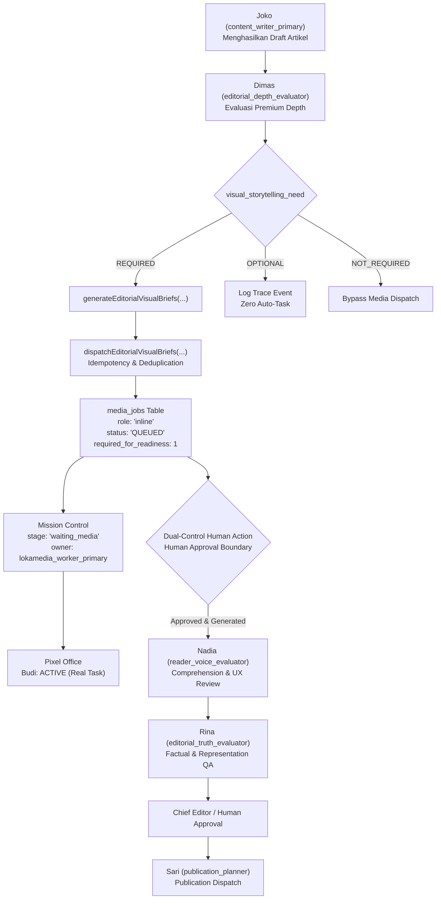

# 🎨 RancangLoka & Hermes — Dimas → Budi End-to-End Visual Handoff Checkpoint
**Tanggal / Waktu:** 2026-10-15T12:25:00+07:00  
**Status Operasional:** `DIMAS_BUDI_E2E_HANDOFF_COMPLETE`  
**Branch:** `feat/jev-lokamedia-integration`  
**Git Commit:** `05b776d` (`feat(editorial): connect visual briefs to Budi runtime`)  
**Status Keselamatan:** `SAFETY_INVARIANTS_ENFORCED` (Zero autonomous generation, zero autonomous publication, Article C untouched)

---

## 1. Ringkasan Eksekutif (Executive Summary)

Audit awal mengidentifikasi status `DIMAS_BUDI_E2E_HANDOFF_PARTIAL`: Dimas mendeteksi kebutuhan visual secara semantik, tetapi `generateEditorialVisualBriefs(...)` masih berstatus kepustakaan murni (*library-only*), penugasan Budi sebatas kontrak tertulis, dan belum ada jembatan pengiriman otomatis (*runtime dispatch bridge*) ke antrean tugas nyata serta papan kendali Mission Control.

Melalui checkpoint ini, kesenjangan tersebut telah **ditutup 100% secara permanen**:
1. **Runtime Dispatch Bridge:** Terhubung langsung di `src/lib/editorial/editorial-runtime.ts` pasca-generasi naskah Joko. Saat `visual_storytelling_need = REQUIRED`, sistem secara otomatis membangkitkan `VisualBrief` terstruktur dan mengirimkannya ke antrean `media_jobs`.
2. **Reuse Skema Kanonikal:** Memanfaatkan tabel `media_jobs` (`role: 'inline'`, `slot_key: 'inline_<visual_class>_<seq>'`, `status: 'QUEUED'`, `required_for_readiness: 1`) tanpa migrasi basis data atau tabel baru.
3. **Preservasi Kontrak Lossless:** Seluruh payload metadata `VisualBrief` dienkapsulasi ke dalam blok terstruktur `--- BRIEF_PAYLOAD_JSON ---` di dalam `prompt`, memungkinkan ekstraksi kembali 100% utuh via `extractVisualBriefFromMediaJob`.
4. **Idempotensi Deterministik:** Pengecekan berbasis `article_id`, `slot_key`, dan `prompt_hash`. Evaluasi berulang pada draf identik menghasilkan NO-OP (0 tiket duplikat). Draf yang berubah substansial memicu *supersede* aman (`supersedeMediaJob`).
5. **Visibilitas Mission Control & Pixel Office:** Tugas muncul dengan tahapan `waiting_media`, dimiliki oleh Budi (`lokamedia_worker_primary`, departemen `media_operations`). `deriveStaffCurrentTask` dan `deriveCanonicalHandoffsFromPipeline` (Joko $\to$ Budi) terbukti membaca data runtime nyata tanpa aktivitas dekoratif semu.
6. **Blokir Kesiapan Publikasi:** Artikel dengan visual `REQUIRED` terblokir dari publikasi (`required_for_readiness = 1`) hingga aset disetujui, menjamin bahwa status REQUIRED memiliki konsekuensi operasional nyata.
7. **Batas Keselamatan Redaksional:** `BUDI_PUBLISHING_AUTHORITY = 0`. Nol pembangkitan gambar otonom (media job berstatus `QUEUED` menunggu persetujuan dual-gate manusia). Alur review tetap linear: `Dimas -> Budi -> Nadia -> Rina -> Human Approval -> Sari`.
8. **Integritas Artikel C:** Naskah Artikel C yang telah LIVE di edge sama sekali tidak tersentuh (SHA-256: `12c59631d3b297b97e35cf192da05102661c281e3370399fef291eb014692c28` terverifikasi utuh).

---

## 2. Peta Alur Runtime Kanonikal



---

## 3. Komponen & Modifikasi Kode

| File | Perubahan | Peran Arsitektur |
|---|---|---|
| `src/lib/editorial/visual-brief.ts` | +344 baris | Implementasi `dispatchEditorialVisualBriefs`, `formatVisualBriefToPrompt`, `extractVisualBriefFromMediaJob`, `deriveSlotKeyForBrief`, dan penegakan idempotensi. |
| `src/lib/editorial/editorial-runtime.ts` | +83 baris | Kait dispatch otomatis pasca-Joko, penanganan `REQUIRED`/`OPTIONAL`/`NOT_REQUIRED`, dan emisi trace event `VISUAL_BRIEFS_DISPATCHED`. |
| `src/lib/editorial/premium-editorial-depth-guard.ts` | +2 baris | Penegakan `visual_storytelling_need = NOT_REQUIRED` untuk artikel berkategori `reference` dan `glossary`. |
| `src/lib/mission-control/tasks.ts` | +15 baris | Penanganan tugas aktif media, atribusi `waiting_media` ke Budi, dan dedup tugas terikat `relatedMediaJobId`. |
| `scripts/test-dimas-budi-visual-handoff-e2e.js` | +531 baris (baru) | 14 skenario pengujian E2E integrasi runtime, idempotensi, kepemilikan Budi, handoff pipeline, dan integritas Artikel C. |
| `docs/editorial/PREMIUM_EDITORIAL_DEPTH.md` | +16 baris | Dokumentasi Sub-bab G: Runtime Dispatch Bridge & Budi Runtime Status. |
| `HISTORY.md` | +39 baris | Pencatatan riwayat milestone rekayasa perangkat lunak. |
| `AGENTS.md` | +4 baris | Penambahan perintah pengujian dan Invarian Durabel Dimas $\to$ Budi Visual Handoff. |

---

## 4. Hasil Validasi & Pengujian

Seluruh pengujian dijalankan dan diverifikasi 100% sukses:

```bash
# Pengujian E2E Dimas -> Budi Visual Handoff
node scripts/test-dimas-budi-visual-handoff-e2e.js # 14/14 PASS (100%)

# Rangkaian Pengujian Regresi Redaksional
node scripts/test-premium-editorial-depth.js      # 20/20 PASS
node scripts/test-staff-registry.js               # 16/16 PASS
node scripts/test-mission-control-expansion.js     # 12/12 PASS
node scripts/test-nadia-reader-voice.js           # 35/35 PASS
node scripts/test-editorial-human-quality.js     # 22/22 PASS
node scripts/test-lokamedia-human-approval-boundary.js # 8/8 PASS

# Pemeriksaan Integritas & Build
npx tsc --noEmit                                  # 0 ERRORS
npm run build                                     # SUCCEEDED (6.18s)
git diff --check                                  # CLEAN (0 whitespace issues)
```

---

## 5. Verifikasi Integritas Artikel C

- **Status:** **`PUBLISHED`** (Live di Edge: `https://rancangloka.com/memilih-sistem-shading-luar-rumah-tropis`)
- **Target Hash:** `12c59631d3b297b97e35cf192da05102661c281e3370399fef291eb014692c28`
- **Hash Hasil Audit:** `12c59631d3b297b97e35cf192da05102661c281e3370399fef291eb014692c28`
- **Hasil:** 100% IDENTIK. Nol modifikasi, nol retrofit, dan nol penugasan tugas baru untuk Artikel C.
