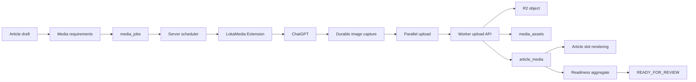

# RancangLoka LokaMedia Extension Architecture

Phase: LokaMedia Phase 1, discovery and design only.

Core status: `RANCANGLOKA_CORE_SYSTEM=PASS`, `CORE_FREEZE=YES`, `AUTO_PUBLISH=OFF`.

Production reference: Worker version `1322e6ff-2c98-4c2e-8850-4af14bb40f9f`; release commit `c13b0f505195ca0c34751f5c681012b08830134f`.

No production D1, R2, article, or deployment mutation is part of this phase.

## Current Canonical Surface

The canonical LokaMedia work is in the current recovery worktree:

- `db/migrations/0005_media_assets_and_article_media.sql`
- `db/migrations/0006_media_jobs_queue.sql`
- `db/migrations/0007_publication_readiness_and_approvals.sql`
- `src/lib/media/service.ts`
- `src/lib/media/jobs-service.ts`
- `src/lib/media/device-auth.ts`
- `src/pages/api/internal/v1/media/upload.ts`
- `src/pages/api/internal/v1/media/jobs/index.ts`
- `src/pages/api/internal/v1/media/jobs/[job_id].ts`
- `src/pages/media/[key].ts`
- `scripts/test-lokamedia-extension.js`
- `scripts/test-publication-readiness.js`

Legacy/admin upload still exists separately:

- `src/pages/api/admin/upload.ts`
- `src/pages/api/admin/media.ts`
- `src/pages/admin/media.astro`

The internal LokaMedia upload path is canonical for the extension. The admin upload endpoint is useful as an operator UI path, but it should not become the extension protocol because it accepts arbitrary filenames and lacks the richer job/idempotency contract.

## Source Of Truth



RancangLoka server owns article state, job state, scheduling order, idempotency, R2 writes, media attachment, and readiness. The extension owns only browser/provider automation, durable local continuation state, capture, transfer, and operator visibility.

## Existing Database Model

Existing durable storage:

- `articles`: article lifecycle, `status`, `featured_image`, `image_alt`, `content_md`, `content_html`, `content_hash`.
- `media_assets`: `asset_id`, `media_type`, `source_type`, `storage_key`, `public_url`, `mime_type`, `width`, `height`, `file_size`, `sha256`, `alt_text`, `status`, `created_at`.
- `article_media`: `id`, `article_id`, `asset_id`, `role`, `slot_key`, `is_active`, `sort_order`, `caption`, `created_at`, `updated_at`.
- `media_jobs`: `job_id`, `article_id`, `article_slug`, `article_title`, `role`, `slot_key`, `media_type`, `prompt`, `alt_text`, `aspect_ratio`, `target_width`, `target_height`, `status`, `created_at`, `updated_at`.
- `media_devices`: `device_id`, `device_name`, `token_hash`, `scope`, `status`, `last_used_at`, `created_at`.
- `article_publication_readiness`: readiness snapshots.
- `article_editorial_approvals`: human approvals tied to article content and featured media.
- `automation_control`: `mode=OFF` is the publication automation guard.

Existing schema is sufficient for the foundation but not for the new extension pipeline. Required relationship already exists:

`article_id -> media_jobs.job_id -> media_jobs.slot_key -> article_media.asset_id -> media_assets.asset_id`.

Missing or incomplete fields for Phase 2:

- `media_jobs.required_for_readiness`
- `media_jobs.priority`
- `media_jobs.prompt_version`
- `media_jobs.prompt_hash`
- `media_jobs.lease_owner`
- `media_jobs.lease_expires_at`
- `media_jobs.heartbeat_at`
- `media_jobs.attempt`
- `media_jobs.last_error`
- `media_jobs.provider_state`
- `media_jobs.capture_state`
- `media_jobs.upload_state`
- `media_jobs.idempotency_key`
- `media_jobs.progress_state_json`
- `media_jobs.captured_blob_ref`
- `media_jobs.provider_conversation_id`
- `media_jobs.provider_response_id`
- `media_jobs.submitted_at`
- `media_jobs.completed_at`
- A progress/event table for throttled durable timeline events.
- A uniqueness constraint for one active job per `article_id + slot_key` where not terminal.

`EXISTING_SCHEMA_SUFFICIENT=PARTIAL`.

## Article Media Requirements

Each required visual is an independent media job. Jobs target article slots, not whole articles.

Deterministic slot examples:

- `featured`: cover image, role `featured`, required for readiness.
- `cross_ventilation`: inline diagram/photo for airflow concept.
- `window_detail`: inline close-up/detail image.
- `material_comparison`: inline comparison visual.

Requirement identity:

`article_id + slot_key` identifies the editorial need. `media_job_id` identifies one processing attempt. `media_asset_id` identifies the validated binary. `article_media` binds the winning asset to the slot.

Do not depend only on `image1`, `image2`, or positional numbering. Numbering can be a display fallback; `slot_key` is the contract.

## Article Placement Contract

Preferred body contract:

```text
{{media:cross_ventilation}}
{{media:window_detail}}
{{media:material_comparison}}
```

Renderer resolution:

1. Parse `{{media:<slot_key>}}`.
2. Query active `article_media` for `article_id + slot_key + is_active=1`.
3. Join `media_assets`.
4. Render figure/image only when asset status is `VALIDATED`.
5. If missing in preview/admin, render a non-public placeholder.
6. If missing in public article, omit or render editorial-safe fallback according to page policy.

The extension must never edit article Markdown or HTML. It only fulfills jobs. Current article format is compatible with a minimal renderer extension because existing articles without anchors continue to render unchanged, and current featured media compatibility mirrors can remain in place.

`MEDIA_SLOT_RENDERING_FEASIBLE=YES`.

## Media Job State Machine

Canonical Phase 2 states:

| State | Owner | Persisted data | Entry | Exit | Retry | Recovery |
|---|---|---|---|---|---|---|
| `QUEUED` | Server | job contract | Requirement created | Lease acquired | Yes | Eligible for scheduler |
| `LEASED` | Server | lease owner/expiry | Atomic claim | Prompt work starts | Yes | Expired lease recoverable |
| `PROMPT_PREPARING` | Extension | prompt hash/context | Lease active | Prompt ready | Yes | Rebuild from server prompt |
| `PROMPT_READY` | Extension/server | prompt version/hash | Prompt prepared | Submit to provider | Yes | Safe to resubmit after reconciliation |
| `PROMPT_SENDING` | Extension | submitted_at | Provider form send begins | Provider accepted | Maybe | Reconcile tab/conversation |
| `PROMPT_ACKNOWLEDGED` | Extension | provider ids when available | Provider accepted | Generation visible | Maybe | Reconcile with submitted prompt |
| `GENERATING` | Provider/extension | elapsed only | Generation starts | Image detected | Yes | Reopen/reconcile provider page |
| `IMAGE_DETECTED` | Extension | candidate fingerprint | New image seen | Capture starts | Yes | Verify newness before capture |
| `CAPTURING` | Extension | capture method | Asset extraction starts | Binary durable | Yes | Retry capture from detected asset |
| `CAPTURED` | Extension | blob ref, sha256, mime, dimensions | Binary stored locally | Upload queued | Yes | Resume upload without regeneration |
| `UPLOAD_QUEUED` | Server/extension | upload task | Capture complete | Upload starts | Yes | Keep blob, wait for lane |
| `UPLOADING` | Extension/server | bytes/progress | Transfer begins | Worker response | Yes | Query job before reupload |
| `UPLOAD_RECEIVED` | Server | asset candidate | Worker accepts binary | Attach starts | Reconcile | Query receipt/asset |
| `ATTACHING` | Server | asset/job relation | Asset valid | Binding written | Reconcile | Re-run attach idempotently |
| `ATTACHMENT_CONFIRMED` | Server | asset_id, article_media id | Binding exists | Complete | Reconcile | Return receipt |
| `COMPLETE` | Server | terminal receipt | Attachment confirmed | None | No | Local may mark complete after reconcile |
| `WAITING_RETRY` | Server | next_retry_at/error | Retryable failure | Retry due | Yes | Scheduler requeues |
| `RECOVERING` | Server/extension | recovery reason | Restart/lost response | Reconciled state | Yes | Prefer query before side effects |
| `AUTH_REQUIRED` | Extension | auth reason | Provider/server auth missing | Human signs in | Yes | No automated retries |
| `PROVIDER_BLOCKED` | Extension | provider reason | Rate/abuse block | Human clears | Maybe | Pause provider lane |
| `USER_ACTION_REQUIRED` | Extension/server | instruction | Human needed | Human resolves | Maybe | Visible queue state |
| `FAILED_TERMINAL` | Server | final error | Non-retryable | Supersede/new job | No | Preserve diagnostics |
| `SUPERSEDED` | Server | replacement job id | Requirement changed | None | No | Ignore old side effects |
| `CANCELLED` | Server/human | actor/reason | Operator cancels | None | No | Extension stops work |

## Server Scheduler

Server owns ordering. The extension asks for the next lease; it does not infer queue order from the admin UI or provider DOM.

Inputs:

- `priority`: `URGENT`, `HIGH`, `NORMAL`.
- `required_for_readiness`.
- `role`: featured before inline.
- Article fairness.
- `sequence` or slot sort order.
- `created_at`.
- retry cooldown.
- lease availability.

Fairness algorithm:

```text
candidate_jobs =
  jobs where state in (QUEUED, WAITING_RETRY)
  and retry_due
  and no active unexpired lease
  and article is draft

group candidates by priority
for priority in URGENT, HIGH, NORMAL:
  group by article_id
  sort article groups by oldest unblocked required job, then article created_at
  for pass in featured, inline_sequence_1, inline_sequence_2, ...:
    for each article group:
      pick one job matching pass
      if found: return atomic lease for that job
```

This produces approximately:

`A cover -> B cover -> C cover -> A inline 1 -> B inline 1 -> C inline 1 -> A inline 2`.

Within the same article and pass, choose higher `required_for_readiness`, lower `sequence`, then older `created_at`.

## Job Leasing

Lease claim must be atomic:

```sql
UPDATE media_jobs
SET status = 'LEASED',
    lease_owner = ?,
    lease_expires_at = ?,
    heartbeat_at = CURRENT_TIMESTAMP,
    updated_at = CURRENT_TIMESTAMP
WHERE job_id = ?
  AND status IN ('QUEUED', 'WAITING_RETRY', 'RECOVERING')
  AND (lease_expires_at IS NULL OR lease_expires_at < CURRENT_TIMESTAMP);
```

If changed rows equals `1`, the extension owns the lease. If `0`, another worker owns it or the job moved.

Lease duration recommendation: 5 minutes with 60-second heartbeat. Provider generation may run longer, but the extension must heartbeat while active. Expired jobs enter `RECOVERING`; recovery reconciles server state, provider state, and local captured blob before any new side effect.

## Multi-Lane Pipeline

Locked initial concurrency:

- `CHATGPT_GENERATION_CONCURRENCY=1`
- `IMAGE_CAPTURE_CONCURRENCY=1`
- `UPLOAD_CONCURRENCY=2`
- `SERVER_RECONCILIATION=parallel where safe`

Boundary: `CAPTURED`.

Once Job A reaches `CAPTURED`, the extension persists the binary and capture metadata, releases the provider lane, queues upload, and may start Job B generation. Upload A must not block generation B.

`GENERATION_SERIAL_TRANSFER_PARALLEL=YES`.

## Backpressure

Recommended initial thresholds:

- `MAX_PENDING_CAPTURED_ASSETS=4`
- `MAX_PENDING_CAPTURED_BYTES=20 MiB`
- pause provider acquisition when either threshold is reached.

Recovery behavior:

1. Upload workers drain existing captured blobs.
2. If blob missing for `CAPTURED`, move job to `RECOVERING`.
3. Reconcile server first.
4. If no attachment exists and blob is gone, move to `WAITING_RETRY` with incremented attempt.

Do not allow unbounded blobs in service-worker RAM or IndexedDB.

## Extension Durable Storage

Small durable state: `chrome.storage.local`.

Large captured binary: IndexedDB object store keyed by `job_id + sha256`.

Required local checkpoint:

- active job id
- server job revision/state
- lease owner
- prompt version/hash
- provider tab id
- provider conversation id if available
- submitted_at
- response identity if available
- capture state
- blob store key
- sha256/mime/dimensions
- upload state
- last confirmed server receipt

After browser or service-worker restart:

- `CAPTURED + blob exists` resumes upload.
- `UPLOADING + no receipt known` queries server job/asset/attachment first.
- `GENERATING` reconciles provider tab and prompt identity.
- Missing provider auth becomes `AUTH_REQUIRED`.

## ChatGPT Job Correlation

`IMAGE_JOB_CORRELATION_CONTRACT`:

The extension must correlate a generated image to the active job using `job_id`, prompt version/hash, provider tab identity, conversation identity where available, submission timestamp, response identity where available, generation sequence, baseline image fingerprints captured before submission, and the new image fingerprint after generation. Initial generation concurrency is one, but correlation must still reject "newest image" shortcuts because old visible images can survive page reloads and virtualized DOM changes.

Minimum acceptance rules:

- Active provider lane contains exactly one leased job.
- Prompt hash submitted equals server job prompt hash.
- Candidate image appears after `submitted_at`.
- Candidate fingerprint was not in baseline.
- Dimensions/mime pass local preflight.
- Captured binary sha256 is persisted before provider lane release.

## Image Capture

Capture priority:

1. Highest-quality direct download/asset URL.
2. Blob or binary response already available in page/session.
3. Browser fetch of resolved asset.
4. Client-side conversion only when needed for supported MIME/size.
5. Screenshot as last resort.

The captured result must be durably stored before the provider lane is released.

## Upload Path

Current upload mechanisms:

- Admin endpoint: browser `FormData` multipart to `/api/admin/upload`, direct R2 write under caller-supplied filename, local fallback to base64 data URL.
- Internal endpoint: multipart or direct binary to `/api/internal/v1/media/upload`, server validates article draft state, magic bytes, dimensions, MIME, size, SHA-256, R2 write, `media_assets`, `article_media`, and optional job transition to `ATTACHED`.

Target upload mechanism:

`Captured Blob -> multipart or binary fetch with upload progress -> Worker -> validation -> R2 -> media_assets -> article_media -> receipt`.

Avoid base64-in-JSON for large images. Use `XMLHttpRequest.upload.onprogress` or an equivalent browser transfer primitive for real byte progress if `fetch` upload progress is unavailable in the extension runtime.

## Upload Idempotency

Upload metadata must bind to the canonical job:

- `protocol_version`
- `job_id`
- `article_id`
- `slot_key`
- `role`
- `sequence`
- `prompt_version`
- `prompt_hash`
- `sha256`
- `idempotency_key`
- `mime`
- `dimensions`
- `alt_text`

Server validation:

1. Job exists and belongs to article.
2. Article is still `draft`.
3. Job slot and upload metadata match.
4. Job is not terminal, superseded, or cancelled.
5. SHA dedupe is applied before R2 write when possible.
6. One active attachment exists per `article_id + slot_key`.
7. Retry with same idempotency key returns the prior receipt.

Retries must not create duplicate R2 objects, duplicate `media_assets`, or duplicate active `article_media`.

## Server Receipts And Reconciliation

The extension cannot declare success. It may only report the latest server-confirmed state.

Receipt states:

- `UPLOAD_ACCEPTED`
- `ASSET_EXISTS`
- `UPLOAD_RECEIVED`
- `ATTACHMENT_CONFIRMED`
- `REJECTED`
- `RETRYABLE_ERROR`
- `TERMINAL_ERROR`

`COMPLETE` is valid only after the server confirms attachment. If upload succeeded but the response was lost, the extension reconnects, queries job status/receipt by `job_id` and `idempotency_key`, sees `ATTACHMENT_CONFIRMED`, and marks local state `COMPLETE`.

## Article Readiness

`articles.status` remains `draft`.

Media readiness is separate:

- `WAITING_MEDIA`
- `MEDIA_IN_PROGRESS`
- `MEDIA_NEEDS_ATTENTION`
- `READY_FOR_REVIEW`

Each requirement has `required_for_readiness=true/false`. `READY_FOR_REVIEW` occurs only when all required media slots have an active `article_media` binding to a `VALIDATED` `media_assets` row. Media operations never publish the article.

## Progress Contract

Progress surfaces:

- Global queue
- Article
- Media job
- Generation
- Capture
- Upload
- Attachment

Events:

- `JOB_PROGRESS`
- `GENERATION_STARTED`
- `IMAGE_DETECTED`
- `CAPTURE_STARTED`
- `CAPTURED`
- `UPLOAD_STARTED`
- `UPLOAD_PROGRESS`
- `UPLOAD_RECEIVED`
- `ATTACHMENT_CONFIRMED`
- `JOB_COMPLETE`
- `JOB_RECOVERING`
- `JOB_FAILED`

Generation progress is indeterminate plus elapsed time. Do not invent ChatGPT percentages. Upload progress uses real `bytes_sent`, `bytes_total`, percentage, transfer rate, and ETA only when reliable. High-frequency upload progress is local-first and throttled before server persistence.

## Queue UI Contract

Admin groups jobs by article:

```text
Article #81
Media 2 / 4

✓ Cover
✓ Ventilation diagram
● Bedroom image - Generating - 00:42
↑ Window detail - Uploading - 71%
```

Summary counters:

- Drafts needing media
- Generating
- Uploading
- Needs attention
- Ready for review

## Extension UI Contract

Minimal operator UI:

- connection status
- total jobs
- complete
- active
- waiting
- current generation article/slot/elapsed time
- transfers article/slot/real percentage
- next jobs

The extension is not a second CMS.

## Failure Recovery Matrix

| Failure | Resolution |
|---|---|
| ChatGPT tab closed | `RECONCILE`, reopen tab if auth exists; otherwise `USER_ACTION_REQUIRED` |
| ChatGPT page reload | `RECONCILE`, rebuild provider context and verify prompt hash |
| Browser restart | `AUTO_RECOVER` from `chrome.storage.local` and IndexedDB |
| Service worker sleep | `AUTO_RECOVER` from durable checkpoint |
| Network offline | `RETRY` with backoff; keep captured blob |
| RancangLoka timeout | `RECONCILE` before retrying upload |
| Upload response lost | `RECONCILE` by `job_id` and idempotency key |
| Duplicate message | `RECONCILE`; ignore if server revision unchanged |
| Duplicate upload | `RECONCILE`; SHA/idempotency returns existing receipt |
| ChatGPT logout | `USER_ACTION_REQUIRED` |
| Provider DOM drift | `USER_ACTION_REQUIRED` after adapter fails safe |
| Generation timeout | `RETRY` until attempt ceiling, then `FAILED_TERMINAL` |
| Wrong/old image visible | `RECONCILE`; reject fingerprint if baseline/old |
| R2 SHA duplicate | `AUTO_RECOVER`; reuse existing `media_assets` |
| Article media slot already filled | `RECONCILE`; if same asset complete, else supersede or require human review |
| Article changed while job active | `RECONCILE`; compare article/job revision and move old job to `SUPERSEDED` |

## Old Cover Bridge Reference

No standalone Cover Bridge extension source was found in the workspace. Available reference material is the current LokaMedia service/test implementation plus the older admin cover upload UI.

Classification:

- `REUSE`: R2 binding, image magic-byte validation, dimension limits, SHA-256 dedupe, `media_assets`, `article_media`, device auth guardrails, internal media upload endpoint concepts.
- `ADAPT`: media job list/detail endpoints, current basic status transitions, admin upload UX affordances, existing publication lease patterns from scheduled publisher.
- `REWRITE`: scheduler, leasing for media jobs, provider adapter, durable extension state machine, ChatGPT correlation, progress protocol, idempotency receipt model.
- `DISCARD`: base64 data URL fallback for large extension transfers, caller-supplied object names, DOM/newest-image-only correlation, any WordPress/legacy CMS assumptions.

## Minimum Backend Changes

`CAN_EXISTING_LOKAMEDIA_SUPPORT_NEW_PIPELINE=PARTIAL`.

Minimum additions:

1. Extend `media_jobs` metadata: priority, required_for_readiness, prompt version/hash, sequence, attempts, lease fields, provider/capture/upload/progress state, idempotency key, error fields.
2. Add atomic `next-job` lease API.
3. Add heartbeat/release/recover API.
4. Add reconcile API by `job_id` and `idempotency_key`.
5. Harden upload API to validate job relationship, slot_key, prompt hash, source type `lokamedia_extension`, and idempotency.
6. Add server receipt table or receipt fields.
7. Add progress event endpoint/table with throttling.
8. Add renderer support for `{{media:slot_key}}`.
9. Add readiness aggregate that checks all required slots, not only featured media.
10. Add duplicate active-job prevention for `article_id + slot_key`.

No parallel source of truth should be introduced.

## Phase 2 Scope

Phase 2 should implement additive migrations and APIs first, then the extension protocol, then the Chrome durable worker and ChatGPT adapter. It should include chaos tests for duplicate messages, duplicate uploads, lost responses, lease expiration, browser restart, provider logout, DOM drift, and article mutation while active.

## Phase 2A Implemented Schema Foundation

Implemented locally in `cover-url-fix-release` only. No remote migration was applied.

Migration:

- `db/migrations/0013_lokamedia_durable_jobs.sql`

Server-canonical D1 fields added to `media_jobs`:

- `sequence`
- `required_for_readiness`
- `priority`
- `prompt_version`
- `prompt_hash`
- `lease_owner`
- `lease_expires_at`
- `heartbeat_at`
- `attempt`
- `max_attempts`
- `next_retry_at`
- `last_error_code`
- `last_error_message_safe`
- `idempotency_key`
- `submitted_at`
- `completed_at`
- `job_revision`
- `superseded_by_job_id`

The migration rebuilds `media_jobs` because the old SQLite `CHECK` constraint only allowed the MEDIA-1 states. Legacy states are mapped during migration:

- `PENDING -> QUEUED`
- `IN_PROGRESS -> LEASED`
- `READY_TO_UPLOAD -> UPLOAD_QUEUED`
- `UPLOADING -> UPLOADING`
- `ATTACHED -> COMPLETE`
- `FAILED -> FAILED_TERMINAL`
- `SKIPPED -> CANCELLED`

Server-canonical state is one column: `media_jobs.status`. Phase 2A intentionally does not add separate `provider_state`, `capture_state`, or `upload_state` columns because those can contradict the canonical lifecycle. Provider continuation, captured blob references, browser tab identity, and local IndexedDB blob keys remain extension-local until a concrete server use case exists.

Terminal states:

- `COMPLETE`
- `FAILED_TERMINAL`
- `SUPERSEDED`
- `CANCELLED`

Active job definition:

`same article_id + slot_key where status NOT IN ('COMPLETE', 'FAILED_TERMINAL', 'SUPERSEDED', 'CANCELLED')`.

Duplicate-active-job guard:

- Database guard: partial unique index `idx_media_jobs_one_active_slot` on `media_jobs(article_id, slot_key)` where status is not terminal.
- Service guard: `hasActiveJobForSlot()` before `createMediaRequirement()`.

Priority model:

- `NORMAL=100`
- `HIGH=200`
- `URGENT=300`

Receipt foundation:

- `media_job_receipts`
- unique idempotency guard on `job_id + idempotency_key + receipt_type`
- receipt types: `UPLOAD_ACCEPTED`, `ASSET_EXISTS`, `UPLOAD_RECEIVED`, `ATTACHMENT_CONFIRMED`, `REJECTED`, `RETRYABLE_ERROR`, `TERMINAL_ERROR`

Progress/timeline foundation:

- `media_job_events`
- durable event types for job, generation, capture, upload, attachment, completion, recovery, and failure.
- safe payloads only; token/cookie/authorization/secret/password/binary/blob/image_data-like keys are redacted by service helper.

Service primitives:

- `createMediaRequirement()`
- `createMediaJob()` compatibility wrapper
- `getMediaJobById()`
- `listMediaJobs()`
- `listArticleMediaJobs()`
- `hasActiveJobForSlot()`
- `transitionMediaJob()`
- `updateMediaJobStatus()` compatibility wrapper
- `supersedeMediaJob()`
- `appendMediaJobReceipt()`
- `getReceiptByIdempotencyKey()`
- `appendMediaJobEvent()`

Phase 2A verification:

- new durable schema tests pass.
- existing LokaMedia tests pass.
- publication readiness tests pass.
- relevant Article/Admin tests pass.
- TypeScript `--noEmit` passes.
- Astro production build passes.

## Phase 2B Implemented Server Control Plane

Implemented locally in `cover-url-fix-release` only. No remote migration, production D1 write, production R2 write, article mutation, deployment, Chrome extension work, ChatGPT connection, or provider automation was performed.

Protocol:

- `LOKAMEDIA_PROTOCOL_VERSION=1`
- Unsupported protocol versions fail with `PROTOCOL_VERSION_UNSUPPORTED`.

Lease constants:

- `MEDIA_JOB_LEASE_SECONDS=300`
- `MEDIA_JOB_HEARTBEAT_SECONDS=60`
- `NO_ELIGIBLE_JOB_RETRY_AFTER_MS=15000`

Control-plane endpoints:

- `POST /api/internal/v1/media/jobs/next`
- `POST /api/internal/v1/media/jobs/[job_id]/heartbeat`
- `GET /api/internal/v1/media/jobs/[job_id]/reconcile`
- `POST /api/internal/v1/media/jobs/[job_id]/release`
- `POST /api/internal/v1/media/jobs/[job_id]/events`
- `GET /api/internal/v1/media/jobs/receipts`

Scheduler algorithm:

1. Filter to schedulable states: `QUEUED`, `WAITING_RETRY`.
2. Exclude terminal, cancelled, superseded, published-article, prompt-invalid, retry-not-due, max-attempted, and actively leased jobs.
3. Sort by `priority DESC`.
4. Apply article fairness by processing lower media pass first: featured pass before inline sequence passes.
5. Within a pass, prefer `required_for_readiness`, then lower `sequence`, older `created_at`, and finally `job_id`.

Fairness policy:

- Cover jobs for all eligible draft articles are selected before inline jobs of the same priority.
- Inline jobs rotate by sequence pass across articles, so one article with many inline requirements cannot monopolize the provider lane ahead of other article covers.

Starvation policy:

- Priority is strict: `URGENT > HIGH > NORMAL`.
- Under a bounded queue where urgent/high arrivals eventually stop, normal jobs are selected deterministically.
- Continuous urgent arrival may intentionally starve normal jobs because editorial urgency is authoritative.

Lease model:

- `acquireMediaJobLease()` performs compare-and-swap on `job_id + job_revision + status + expired/no lease`.
- A successful lease sets `status=LEASED`, `lease_owner`, `lease_expires_at`, `heartbeat_at`, and increments `job_revision`.
- Heartbeat requires the active lease owner and matching job revision, extends the lease, and does not increment `attempt` or `job_revision`.
- Expired lease recovery moves the job to `RECOVERING`, clears stale lease fields, increments `job_revision`, and appends a `JOB_RECOVERING` event.

Attempt semantics:

- Lease acquisition does not increment `attempt`.
- Heartbeat does not increment `attempt`.
- Reconciliation does not increment `attempt`.
- Retry commitment increments `attempt` once and writes `next_retry_at`, safe error code, and safe error message.

Retry policy:

- Retryable: `TRANSIENT_NETWORK`, `SERVER_TRANSIENT`, `PROVIDER_TIMEOUT`.
- Human/operator intervention: `PROVIDER_AUTH`, `PROVIDER_BLOCKED`, `DOM_CONTRACT_DRIFT`.
- Terminal: `VALIDATION_REJECTED`, `TERMINAL_MEDIA_ERROR`.
- Retry uses bounded exponential backoff with small deterministic jitter and no infinite retries.

Reconciliation response:

- protocol version
- `job_id`
- `job_revision`
- canonical `status`
- `article_id`
- `slot_key`
- lease ownership relation
- active lease flag
- `attempt`
- `prompt_version`
- `prompt_hash`
- safe `idempotency_key`
- latest receipt summary
- resolved `asset_id` where known
- attachment confirmation flag
- `next_retry_at`
- safe error state
- `completed_at`
- bounded `recommended_action`

Recommended actions are advisory only: `CONTINUE`, `WAIT`, `RETRY`, `STOP`, `REAUTHENTICATE`, `RECONCILE_LOCAL_CAPTURE`, `COMPLETE`. Canonical `media_jobs.status` remains the source of truth.

Stable error codes include:

- `NO_ELIGIBLE_JOB`
- `LEASE_CONFLICT`
- `LEASE_EXPIRED`
- `LEASE_NOT_OWNER`
- `JOB_REVISION_CONFLICT`
- `INVALID_TRANSITION`
- `RETRY_NOT_DUE`
- `ARTICLE_NOT_DRAFT`
- `JOB_SUPERSEDED`
- `JOB_TERMINAL`
- `PROTOCOL_VERSION_UNSUPPORTED`
- `AUTH_REQUIRED`

Device auth scope remains narrow. Media device credentials can operate media jobs, leases, progress, reconciliation, and receipt lookup. They cannot publish, delete articles, arbitrarily edit articles, mutate settings, deploy, or write arbitrary R2 paths.

Phase 2B verification:

- scheduler/fairness tests pass.
- lease race tests pass for 2 workers / 1 job, 10 workers / 1 job, and 10 workers / many jobs.
- heartbeat, lease expiry, controlled release, retry, reconciliation, receipt lookup, stale-client, progress event, and no-job tests pass.
- Phase 2A tests still pass.
